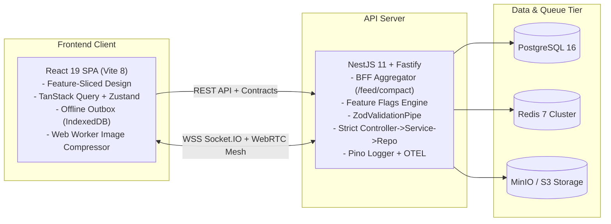

# 🌐 Social Network — Documentation Portal

Welcome to the technical documentation repository for the **Social Network** platform! This project is a proprietary, full-stack monorepo application engineered for high-concurrency social feeds, real-time messaging, ephemeral stories, interactive polls, and privacy.

---

## 🗺️ Unified Documentation Sitemap

```text
docs/
├── 🏛️ architecture/           # Core System & Software Architecture
│   ├── README.md              # Monorepo topology, C4 model, tech stack & domain boundaries
│   ├── backend.md             # NestJS 11 + Fastify, 4-tier layering & BullMQ
│   ├── frontend.md            # React 19 + Vite 8 + FSD & state management
│   ├── database.md            # PostgreSQL 16 Prisma schema & complete ERD diagram
│   ├── realtime.md            # Socket.IO /messenger gateway & presence engine
│   └── security.md            # Auth, Argon2id, AES-256-GCM E2EE & Cosign
│
├── 📡 api/                    # API Specifications & Protocol Contracts
│   ├── README.md              # API portal, auth headers, status codes & Swagger UI
│   ├── http-api.md            # Comprehensive REST API reference & endpoints
│   ├── websocket.md           # Real-time Socket.IO event protocol & client reference
│   └── contracts.md           # Single-source-of-truth Zod schemas & shared types
│
├── 🤝 contributing/           # Authorized Contributor Guides
│   ├── README.md              # Contributor hub, values & onboarding roadmap
│   ├── getting-started.md     # 5-minute local environment setup
│   ├── coding-standards.md    # Architectural invariants & Conventional Commits
│   ├── workflow.md            # GitHub Issues, branch strategy & PR lifecycle
│   └── testing.md             # Testing handbook (E2E, Vitest, Stryker, k6)
│
├── 🤖 ci/                     # Continuous Integration & Tooling
│   ├── README.md              # GitHub Actions pipeline catalog & workflows
│   └── tooling.md             # Developer tooling, quality gates & local parity
│
├── 🚀 deployment/             # Deployment & Cloud Operations
│   ├── README.md              # Deployment topologies & environment variables matrix
│   ├── docker.md              # Multi-stage non-root Docker builds & caching
│   ├── cloud.md               # Vercel SPA + Render backend + UptimeRobot
│   ├── gitops.md              # Terraform automation & AWS OIDC setup
│   └── canary-blue-green.md   # Zero-downtime canary & blue-green rollouts
│
├── ⚙️ operations/             # SRE, Resilience & Performance
│   ├── README.md              # SRE handbook, reliability philosophy & SLAs/SLOs
│   ├── database-migrations.md # Zero-downtime Expand / Contract pattern
│   ├── ha-dr.md               # Multi-region High Availability & DR strategy
│   ├── backup-replication.md  # AES-256 encrypted backups & S3 replication
│   └── performance-tuning.md  # Postgres memory tuning & stress benchmarks
│
├── 📊 monitoring/             # Telemetry & Observability
│   ├── README.md              # Monitoring stack overview & quick launch
│   ├── quickstart.md          # Local Prometheus & Grafana setup
│   ├── setup.md               # Alerting rules & SLO metrics
│   └── tracing.md             # Distributed tracing with OTEL & Tempo
│
├── 📖 runbooks/               # Standard Operating Procedures (SOPs)
│   ├── README.md              # Runbook catalog & incident severity matrix
│   ├── incident-response.md   # Live outage triage & coordination
│   ├── dr-failover.md         # Multi-region emergency failover procedure
│   ├── database-restore.md    # Emergency database restore drill
│   ├── deployment-rollback.md # Release rollback procedure
│   ├── redis-self-healing.md  # Redis OOM & memory mitigation
│   └── secret-rotation.md     # Zero-downtime secret & token rotation
│
└── 📐 adr/                    # Architecture Decision Records
    ├── README.md              # ADR registry, status table & decision criteria
    ├── 001-monorepo-nx-and-zod-contracts.md
    ├── 002-zero-packages-folder-and-path-aliases.md
    ├── 003-supply-chain-security-and-cosign.md
    └── 004-correlation-id-and-observability-architecture.md
```

---

## ⚡ Quick Links for Contributors

| What are you looking for?                               | Guide Link                                                                     |
| :------------------------------------------------------ | :----------------------------------------------------------------------------- |
| **I want to run the project locally**                   | [Getting Started Guide](contributing/getting-started.md)                       |
| **I want to understand how the codebase is structured** | [System Architecture Overview](architecture/README.md)                         |
| **I want to know the coding & Git commit rules**        | [Coding Standards](contributing/coding-standards.md)                           |
| **I want to submit a Pull Request**                     | [Contribution & PR Workflow](contributing/workflow.md)                         |
| **I want to see the REST API endpoints**                | [REST API Reference](api/http-api.md)                                          |
| **I want to integrate real-time WebSockets**            | [WebSocket Protocol Specification](api/websocket.md)                           |
| **I want to inspect the Database models**               | [Database Schema & ERD](architecture/database.md)                              |
| **I want to run tests and benchmarks**                  | [Testing Guide](contributing/testing.md)                                       |
| **I want to inspect developer tooling & scripts**       | [Developer Tooling & Quality Gates](ci/tooling.md)                             |
| **I want to deploy to production**                      | [Cloud Deployment](deployment/cloud.md) / [Docker Guide](deployment/docker.md) |
| **I want to view operational runbooks**                 | [Operational Runbooks](runbooks/README.md)                                     |

---

## 🏛️ System Architecture at a Glance



---

## 🤝 Contributing & Community

Eternal welcomes issue reports and feature discussions. Authorized code, documentation, and creative contributions are subject to the contributor terms in Section 7 of LICENSE.md. Confirm those terms and your authority to submit before acceptance. Read the [licensing policy](legal/README.md) and [LICENSE.md](../LICENSE.md) before starting work. Technical instructions in these documents grant no additional software license.

1. Review the [Code of Conduct](../CODE_OF_CONDUCT.md).
2. Set up your local machine using the [Getting Started Guide](contributing/getting-started.md).
3. Follow the [Coding Standards](contributing/coding-standards.md) and [Contribution Workflow](contributing/workflow.md).
4. Run tests with the [Testing Guide](contributing/testing.md).
5. After confirming contributor terms and authorization, submit a Pull Request following Conventional Commits!
