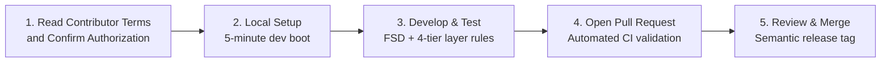

# 🤝 Contributing to Social Network

Eternal is a proprietary, full-stack application built for real-time scale, privacy, and community. This handbook is for authorized maintainers and contributors. Read [LICENSE.md](../../LICENSE.md) and the [licensing policy](../legal/README.md). Unless a separate written agreement provides otherwise, intentionally submitted contributions accepted under Section 7 of LICENSE.md grant the contributor license specified there. Confirm those terms and your authority to submit in the pull request template.

Issue reports and feature discussions are welcome. Access to this handbook does not authorize copying, modifying, running, or redistributing proprietary materials. Existing legal permissions and third-party licenses remain unaffected.

---

## 🧭 Contributor Journey

---

## 📚 Contributor Handbook Index

| Guide                                                    | Summary                                                             |
| :------------------------------------------------------- | :------------------------------------------------------------------ |
| **[Local Getting Started](getting-started.md)**          | Step-by-step 5-minute setup with Docker, pnpm, and Prisma           |
| **[Contribution Workflow](workflow.md)**                 | GitHub Issues, branch conventions, PR lifecycle, and code review    |
| **[Coding Standards & Invariants](coding-standards.md)** | Backend 4-tier architecture, React FSD layers, Zod validation       |
| **[Testing & Verification](testing.md)**                 | Running Jest E2E, Vitest integration, mutation, and k6 stress tests |

---

## 🎯 How Can You Contribute?

1. **Bug Reports & Feature Ideas**: Search existing [GitHub Issues](https://github.com/rakuzan-knu/social-network/issues). If not found, open a new issue using our templates.
2. **Code Contributions**: Look for issues labeled [`good first issue`](https://github.com/rakuzan-knu/social-network/labels/good%20first%20issue) or [`help wanted`](https://github.com/rakuzan-knu/social-network/labels/help%20wanted).
3. **Documentation**: Improve guides, fix typos, add diagrams, or expand API examples in `docs/`.
4. **Performance & Security**: Conduct benchmarks or report security vulnerabilities privately via GitHub Security Advisories.

---

## 📜 Code of Conduct

All participants in our project are expected to adhere to our [Code of Conduct](../../CODE_OF_CONDUCT.md). Please be respectful, constructive, and inclusive.
